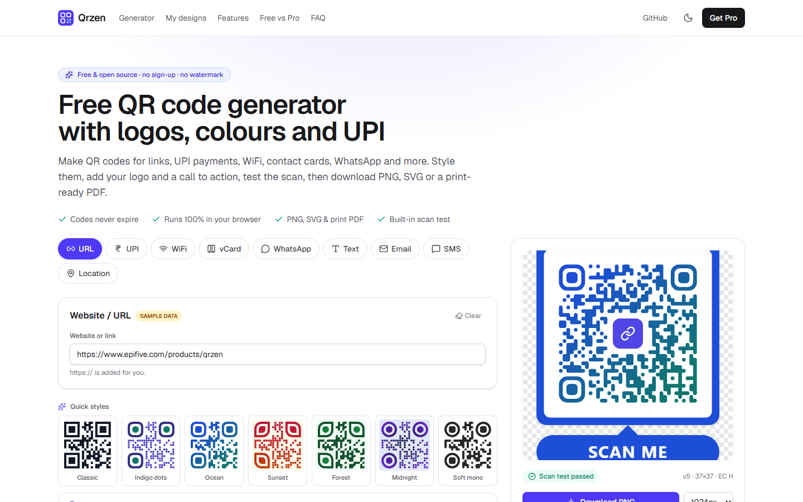
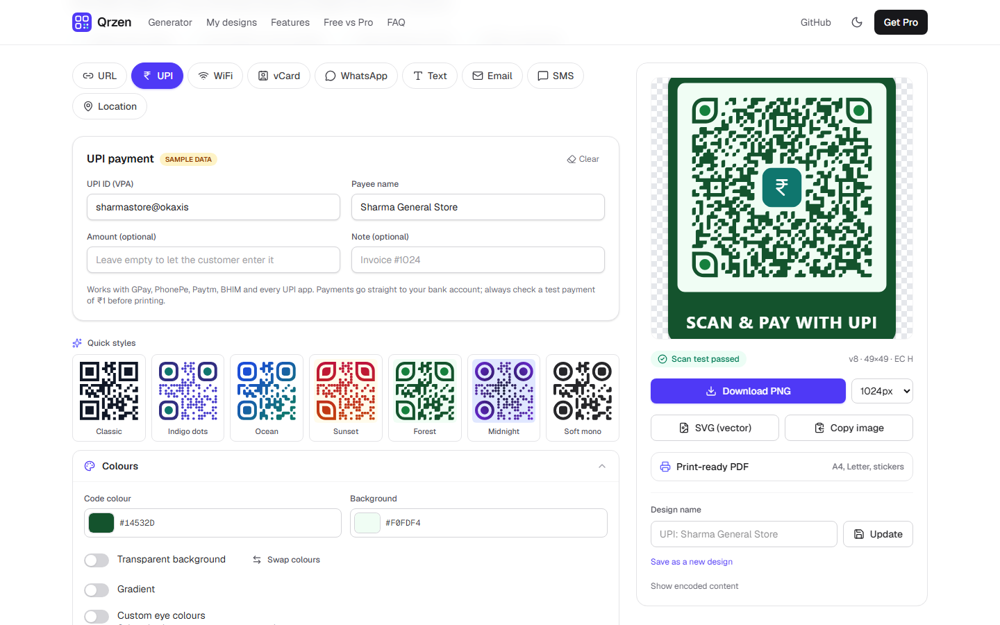
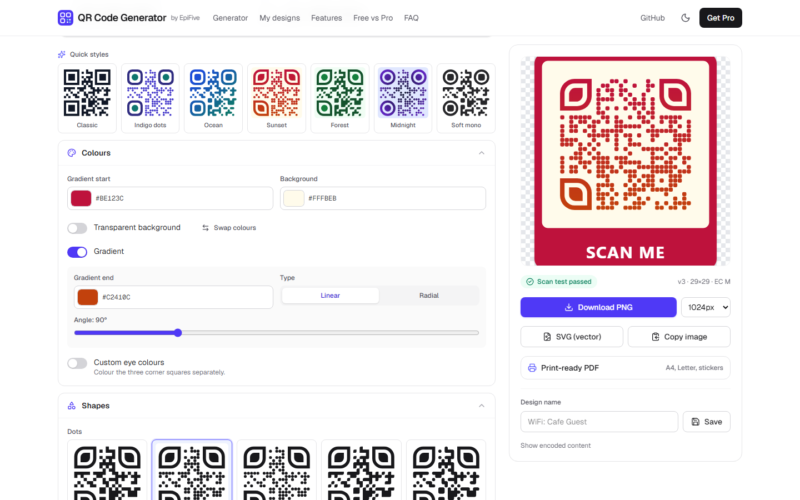
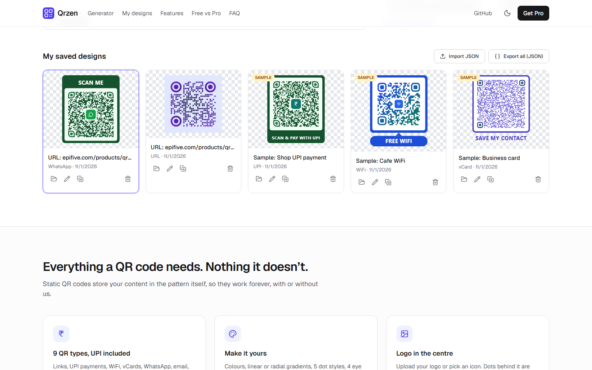
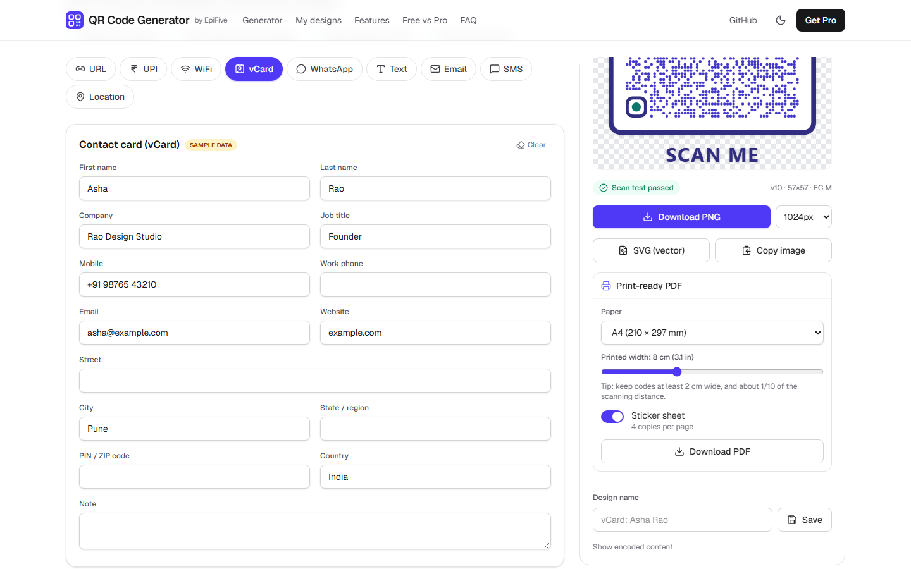
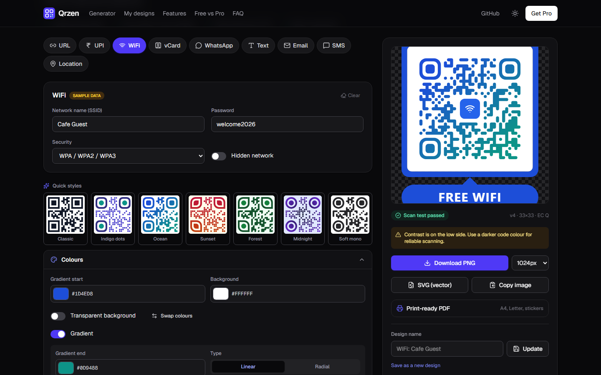
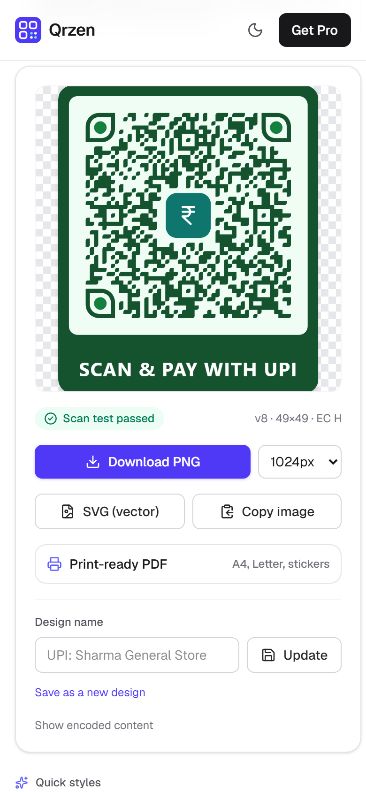

# EpiFive QR Code Generator

**A free, open-source QR code generator that runs entirely in your browser.** Make QR codes for links,
UPI payments, WiFi, contact cards (vCard), WhatsApp, email, SMS, text and map locations. Style them with
colours, gradients, dot and eye shapes, put your logo in the centre, add a frame with a call to action, check
that the code scans, and download PNG, SVG or a print-ready PDF. No sign-up, no watermark, no tracking.

Built with Next.js 16, React 19 and Tailwind CSS 4 as a static site, so it deploys anywhere.

**Live demo:** https://qr-code-generator-demo.pages.dev (sample designs are marked "Sample").



## Features

- **9 QR types:** URL, plain text, **UPI payment** (`upi://pay` with payee, name, amount and note), WiFi
  (WPA/WEP/open, hidden networks), vCard 3.0 contact, email, SMS, WhatsApp chat (`wa.me`) and location
  (Google Maps link or `geo:` URI). Every form validates its input (UPI IDs, emails, coordinates, WPA length…).
- **Styling:** code and background colours, transparent background, linear or radial gradients, 5 dot styles
  (square, rounded, dots, classy, fluid), 4 eye frame and 4 eye centre shapes, separate eye colours,
  quiet-zone margin, error-correction level L/M/Q/H and 7 one-click style presets.
- **Logo in the centre:** upload PNG/JPG/SVG/WebP or pick a built-in icon. Dots behind the logo are cleared
  and error correction is raised to H automatically.
- **Frames with call-to-action text:** banner, top banner, speech bubble and outline, with quick texts like
  "SCAN TO PAY" or "FREE WIFI".
- **Built-in scan test:** every design is decoded in the browser with ZXing-C++ (WebAssembly, self-hosted), plus
  warnings for low contrast, inverted colours, a missing quiet zone or an oversized logo.
- **Export:** PNG from 256 to 4096 px, vector SVG, copy to clipboard, and **print-ready PDF** on A4, US Letter,
  A5, A6 or "fit to code", with a chosen print width in cm and an optional sticker-sheet mode.
- **Saved designs** in the browser's localStorage: open, rename, duplicate, delete, and export/import all
  designs as JSON (your data is never locked in).
- **Private:** nothing is uploaded, no cookies, no analytics, no third-party requests.
- **SEO pages** for each type (`/upi-qr-code-generator`, `/wifi-qr-code-generator`, …), sitemap, Open Graph image,
  light and dark mode, keyboard and screen-reader friendly.

| UPI with logo and frame | Styles and shapes | Saved designs |
| --- | --- | --- |
|  |  |  |
| **Print-ready PDF** | **Dark mode** | **Mobile** |
|  |  |  |

## Free vs Pro

Free does the whole job for static QR codes. **QR Code Generator Pro** is a self-hosted server app (Next.js + SQLite) for
codes you can change after printing, with stats, bulk and an API, for a one-time price.

| Feature | Free | Pro |
| --- | :---: | :---: |
| Static QR codes (9 types incl. UPI, WiFi, vCard) | ✅ | ✅ |
| Colours, gradients, shapes, logo, frames | ✅ | ✅ |
| PNG / SVG / print PDF export | ✅ | ✅ |
| Saved designs + JSON export | Browser | Server database |
| Dynamic QR codes (edit the destination after printing) | — | ✅ |
| Short redirect links on your own domain | — | ✅ |
| Scan analytics: time, country, device, browser, referrer (no cookies) | — | ✅ |
| Password protection and expiry dates for links | — | ✅ |
| Bulk generation from CSV → ZIP of PNG/SVG | — | ✅ |
| REST API with API keys | — | ✅ |
| Team accounts and white-label branding | — | ✅ |

**Get Pro: https://www.epifive.com/products/qr-code-generator-pro** (₹1,999 / $29, one time, 1 year of updates and support).

## Quick start

```bash
git clone https://github.com/epifive/qr-code-generator.git
cd qr-code-generator
npm install
npm run dev        # http://localhost:3000
```

Other scripts:

```bash
npm test           # unit + scan tests (vitest; renders every style and decodes it with ZXing)
npm run lint
npm run build      # static site in out/
```

Requirements: Node.js 20.9 or newer.

## Deploy

`npm run build` creates a fully static site in `out/`. Host it anywhere:

- **Cloudflare Pages:** `npx wrangler pages deploy out --project-name my-qr-code-generator`, or connect the repo with build
  command `npm run build` and output directory `out`.
- **Vercel / Netlify:** import the repo; framework preset Next.js (static export) and output `out`.
- **Any web server** (Nginx, Apache, S3, GitHub Pages): upload the contents of `out/`. Serve `.wasm` files as
  `application/wasm` for the scan test.

Set `NEXT_PUBLIC_SITE_URL` (e.g. `https://qr.example.com`) before building so canonical URLs, the sitemap and
the Open Graph image use your domain.

## How it works

| Path | What |
| --- | --- |
| `src/lib/payloads.ts` | Builds and validates the encoded text for each QR type (UPI, WiFi escaping, vCard 3.0…) |
| `src/lib/qr.ts` | Encodes text into a module matrix with the MIT [`qrcode`](https://github.com/soldair/node-qrcode) package |
| `src/lib/render.ts` | Pure styled-SVG renderer (dots, eyes, gradients, logo, frames) and scan warnings |
| `src/lib/exporters.ts` | PNG/SVG/PDF export ([jsPDF](https://github.com/parallax/jsPDF), loaded on demand) |
| `src/lib/scan.ts` | In-browser scan test with [zxing-wasm](https://github.com/Sec-ant/zxing-wasm) |
| `src/lib/storage.ts` | Saved designs, drafts and JSON import/export (localStorage) |
| `tests/` | Vitest suites: payload builders and scan tests (resvg + ZXing) for every style combination |

## Contributing

Bug reports and pull requests are welcome. Please open an [issue](https://github.com/epifive/qr-code-generator/issues)
first for larger changes, and run `npm test`, `npm run lint` and `npm run build` before sending a PR.

## More from EpiFive

- More open-source projects: https://www.epifive.com/open-source
- Need a custom app or a QR system built for your business? https://www.epifive.com/services#custom-app-development

## Credits

QR encoding by [node-qrcode](https://github.com/soldair/node-qrcode) (MIT), decoding by
[ZXing-C++](https://github.com/zxing-cpp/zxing-cpp) via zxing-wasm (MIT/Apache-2.0), PDF by jsPDF (MIT), icons by
[Lucide](https://lucide.dev) (ISC). QR Code is a registered trademark of DENSO WAVE INCORPORATED.

## License

[MIT](LICENSE) © 2026 EpiFive
